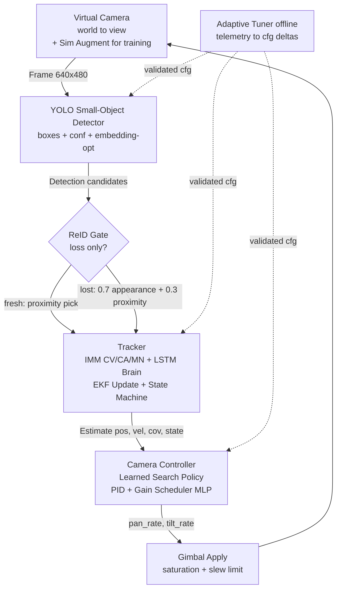

# Architecture v2 — Autonomous Adaptive PAT (Detailed)

## 1. Intent
v1 is a classical sense-decide-act loop: threshold detector -> IMM EKF -> state machine -> PID/search gimbal. It is verifiable but brittle on dim beacons, clutter, maneuvers, and fixed gains.

v2 keeps all physics and safety classical. AI is added only as proposer inside deep modules with small interfaces. Classical logic disposes: clamps, timeouts, wall-hold, give-up.

Goals: higher recall, faster reacquire, maneuver agility, auto-adapt gains.
Non-goals: end-to-end black box, LLM in real-time loop, multi-target, breaking `Detection/Estimate/ControlCommand` contracts.

## 2. System Diagram



Per-frame: `frame -> YOLO -> ReID-if-lost -> Tracker predict/update/state -> Controller track/search -> gimbal`.
Per-loss: `ReID fingerprint match -> IMM reseed`.
Offline: `runs + tune.db -> Adaptive Tuner -> validated cfg`.

## 3. Module Contracts

### 3.1 YOLO Detector — pinned: YOLOv8n/v11n, replaces threshold+blobs
Interface: `detect(frame, predicted_pos, gate_radius_px) -> Detection(valid, centroid_px, bbox, confidence, score, area, rejected[])`
- Input validation at boundary: None/empty -> `valid=False`. Accepts gray + BGR.
- Working: single-class `beacon`, imgsz 640, conf 0.35, NMS IoU 0.5. Rank by `conf + proximity`. Gate filter when latched+fresh, else full-frame.
- Errors: missing weights, timeout, OOM -> `valid=False`, never raise.
- Timing: 15-25ms CPU, <10ms GPU. Timeout 40ms -> fallback `valid=False`.
- Integration: drop-in for `SearchTrackPipeline`. NMS losers -> `rejected[NMS/GATED]` keeps overlay.
- Addition, not modification: `Detection` fields unchanged. New optional `cfg[detector]: yolo_weights, yolo_conf, yolo_imgsz, device`.

### 3.2 ReID — pinned: Siamese-MobileNetV3-Small / OSNet-Tiny, loss only
Interface: `update_template(crop, state)`, `rerank(boxes, template, predicted_pos) -> best_idx, reid_score`
- Working: 64-D embedding (Siamese/OSNet-tiny). Template EMA on LOCKED. On `REACQUIRING/FAILED or missed>10`: score `0.7*cosine + 0.3*proximity`, accept >0.5, trigger reseed.
- Runs 0ms fresh track, ~5ms on loss. No per-frame cost.
- Fallback: low reid_score -> proximity-only pick. Template stale >60 frames -> decay to uniform.
- Why reliable: supervised, offline measurable rank-1, gated execution.

### 3.3 Tracker — pinned: LSTM-32 / GRU/TCN brain + EKF
Interface: `step(detection, frame, hold, ego_rate) -> Estimate`, `get_predicted_pixel()`, `get_gate_radius_px(missed)`, `get_context()`
- Predict: 3x EKF predict (CV/CA/MN differ only by Q scale 0.6/1.2/3.0). LSTM-32 on 30-frame history `[pos, vel, NIS, conf]` outputs `P(CV/CA/MN)` replacing fixed trans matrix. Weighted fuse + covariance mixture.
- Update: `R=R_base*(1.5-0.8*conf)+jitter`, NIS `y'Inv(S)y` gating, adaptive Q boost on high NIS. `reseed()` on `missed>=10 and conf>=0.6` anchors at measurement.
- Gate: Mahalanobis-derived px radius, floor 80px short-loss / 40px long-loss, cap 320px + velocity growth.
- Errors: None measurement -> inflate P, NIS=0. Outlier NIS -> reject + inflate slightly.
- Physics kept: `F` constant-acc, `h=tan` projection, clamps `+-12deg/15deg-s/60deg-s2`.

### 3.4 State + Search Spec — pinned: MLP + PPO + HOLD/GIVE_UP/limit guards
Interface: `sm.update(valid, conf, innovation) -> TrackingState`, `classify_search_case(SearchContext) -> SearchCase`
- States: `SEARCHING->CANDIDATE(1-2 frames)->ACQUIRING->LOCKED(5 frames or 5/10 window)`, `LOCKED->TEMP_LOST(<=3 miss)->REACQUIRING(<=30)->SEARCHING->FAILED(+30)`. Fast-lock `conf>0.7 needs 2`, blink window `5/10` tolerates 50% duty.
- Search cases: `TRACK, STARE, SLEW_PREDICT, EXPAND(spiral), TILE(raster), INTERCEPT, HOLD_SCHEDULED, GIVE_UP, COAST`.
- Learned policy proposes `SLEW/EXPAND/TILE/INTERCEPT/TRACK/STARE`. Classical enforces `HOLD_SCHEDULED` on blink/hidden/limit, `GIVE_UP` after 600 frames, `TILE` after 3s spiral or cold `missed>30`.
- Freshness guard: prediction moves only if `latched and missed<=15 and ego<=1.5deg/s`, else TILE. Prevents chasing diverged velocity.

### 3.5 Camera Controller — pinned: MLP 4-8-3 scheduler + learned policy + PID
Interface: `step(estimate, dt, ctx) -> ControlCommand(pan_rate, tilt_rate, saturated, search_mode, search_case)`
- Search path: `HOLD/GIVE_UP->0`, `SLEW->err*2.0`, `INTERCEPT->(err+vel*0.3)*2.0`, `TILE->raster boustrophedon with wall-bounce`, `EXPAND->spiral angle+=0.45 radius+=0.09 scaled 0.85 + uncertainty boost if latched`.
- Track path: `TEMP_LOST: PID*0.55`, else `PID + 0.7*vel_ff`, `STARE weak cue: *0.3`. Deadzone `0.5px LOCKED else 2.0px`. Saturation to `max_pan/tilt` + back-calculation anti-windup + slew `25deg/s2` + integral decay on `innovation>18`.
- Gain scheduler MLP: `error, vel_mag, innovation, cov -> d_kp,d_kd,d_ff in +-30%`. NN outputs deltas, never rates. Timeout -> last gains.
- Resets `search_frames/raster` on LOCKED.

### 3.6 Virtual Camera + Sim Augment
Interface: `apply_command(pan_rate, tilt_rate, dt)`, `world_to_image()`, `image_to_angle_error()`, `extract_viewport()`
- Production: ideal pinhole `160px/deg`, viewport clamp, rate clamp. Ground truth for geometry.
- Training only: domain randomization — Gaussian/Poisson noise, motion blur, jitter_px, exposure dip, star clutter, blink/hidden. Trains YOLO/ReID/policy. Never in control loop.

### 3.7 Adaptive Tuner — pinned: GP / Contextual bandit (Optuna GP + LightGBM)
Interface: `propose(telemetry) -> cfg deltas`, `validate(deltas) -> PASS/FAIL`
- Input: `cov_trace, vel_mag, SNR, missed, headless metrics, tune.db`. Output: `thresholds, areas, kp/ki/kd, search steps, yolo_conf`.
- Contextual bandit/GP surrogate. Proposes, then full 80-case headless must pass before accept. Never per-frame. Solves fixed-knob brittleness using existing `tune.py` flywheel.

## 4. Data Contracts (stable, additive only)
`Frame(image, frame_id, timestamp)`, `Detection(valid, centroid_px, bbox, confidence, score, area, rejected[])`, `Estimate(pos_px, pos_angle, vel_angle, covariance, model_probs, tracking_state, innovation)`, `ControlCommand(pan_rate, tilt_rate, saturated, search_mode, search_case)`.
New optional: `Detection.embedding`, `ctx.reid_score, maneuver_probs`. Defaults preserve v1 behavior. Validate at YOLO input + controller output boundaries only.

## 5. Key Flows
Track: `YOLO conf>0.45 -> sm CANDIDATE->ACQUIRING->LOCKED -> PID+ff tight deadzone -> gimbal`.
Brief dropout: `missed<=3 -> TEMP_LOST 0.55x coast -> gate 80px wide -> immediate relock`.
Long loss: `REACQUIRING -> ReID rerank -> reseed -> SLEW/INTERCEPT if fresh else TILE -> LOCKED resets search`.
Scheduled blink: `scheduled_hold=True -> HOLD 0-rate, SM frozen, no miss count`.

## 6. Reliability
AI proposes, classical disposes. Each AI has conf + OOD + timeout + fallback to v1 rule. No AI in angle math, saturation, wall-hold, timeouts. Shadow-mode first: log AI choice vs classical, compare offline before enabling.

## 7. Resources
33ms budget: YOLO 15-25ms, ReID 0/5ms, IMM+LSTM 2ms, policy+PID 1ms. Models: YOLO-n <10MB, ReID <2MB, LSTM <200KB, MLP <50KB. ONNX CPU, optional CUDA. Weights external, not in git.

## 8. Data Flywheel
`headless.py --extreme` generates `runs/headless_*.json/md` + `repro` scripts. `tune.py` SQLite stores trials. Tuner + training miners sample failures (X8 sweep-past, blink, clutter) for YOLO/ReID/policy retrain. Metric gates: recall, reacquire time, NIS consistency, coverage%, lock%.

## 9. Verification
Unit per module + contract tests (empty frame, multi-box, gate, reseed, wall, timeout) + `pytest -q` + 1-case smoke + 80-case no-worse + latency profile. No merge on FAIL.

## 10. Migration
Order: yolo-detect -> reid + imm-brain -> search-policy -> pid-scheduler -> adaptive-tune. Each ships behind flag with classical fallback, validated by headless diff.

```
  ╔══════════════════════════════════════════════════════════════════════════════╗
  ║                    ONLINE LOOP  ·  33 ms per frame                           ║
  ╠══════════════════════════════════════════════════════════════════════════════╣
  ║                                                                              ║
  ║  ┌────────────────────┐                                                      ║
  ║  │  Virtual Camera    │  world → view  ·  160 px/deg                         ║
  ║  │  apply_command()   │  viewport clamp · rate clamp · GT geometry           ║
  ║  └─────────┬──────────┘                                                      ║
  ║            │ Frame 640×480                                                   ║
  ║            ▼                                                                 ║
  ║  ┌────────────────────────────────┐                                          ║
  ║  │  YOLO Small-Object Detector    │  ◄── AI #1  (proposer)                   ║
  ║  │  boxes + conf + embedding-opt  │                                          ║
  ║  │  detect(frame, pred, gate_r)   │  timeout 40ms → valid=False              ║
  ║  └─────────┬──────────────────────┘                                          ║
  ║            │ Detection candidates                                            ║
  ║            ▼                                                                 ║
  ║  ┌────────────────────────────────┐                                          ║
  ║  │  ReID Gate  (loss-only)        │  ◄── AI #2  (proposer)                   ║
  ║  │  fresh  → proximity pick       │  0 ms fresh · ~5 ms on loss              ║
  ║  │  lost   → 0.7·cos + 0.3·prox   │  accept >0.5 → reseed                    ║
  ║  └─────────┬──────────────────────┘                                          ║
  ║            │ Detection  (valid, centroid, conf, embedding?)                  ║
  ║            ▼                                                                 ║
  ║  ┌──────────────────────────────────────────────────────────────────────┐    ║
  ║  │                          Tracker                                     │    ║
  ║  │                                                                      │    ║
  ║  │   1. Predict (IMM)  ──►  3× EKF (CV / CA / MN)  ◄── LSTM-32 brain    │    ║
  ║  │                          Q scale 0.6/1.2/3.0         ▲ AI #3         │    ║
  ║  │                                     │                │               │    ║
  ║  │                                     ▼                │               │    ║
  ║  │                              Fused Estimate ◄────────┘               │    ║
  ║  │                           (weighted mean + cov mixture)              │    ║
  ║  │                                     ▲                                │    ║
  ║  │   2. Update ◄── detection ──────────┘                                │    ║
  ║  │      R = R_base·(1.5 − 0.8·conf) + jitter                            │    ║
  ║  │      NIS gating · adaptive Q boost · reseed() on missed≥10 & conf≥0.6│    ║
  ║  │                                                                      │    ║
  ║  │   3. State Machine                                                   │    ║
  ║  │      SEARCHING ─► CANDIDATE(1–2) ─► ACQUIRING ─► LOCKED(5/10)        │    ║
  ║  │                    │                                                 │    ║
  ║  │                    └─► TEMP_LOST(≤3) ─► REACQUIRING(≤30) ─► SEARCHING│    ║
  ║  │                                                          └─► FAILED  │    ║
  ║  └─────────────────────────┬────────────────────────────────────────────┘    ║
  ║                            │ Estimate (pos, vel, cov, state, innovation)     ║
  ║                            ▼                                                 ║
  ║  ┌──────────────────────────────────────────────────────────────────────┐    ║
  ║  │                     Camera Controller                                │    ║
  ║  │                                                                      │    ║
  ║  │   Search Policy (learned) ──►  Classical Disposer ──►  PID + ff      │    ║
  ║  │   ▲ AI #4                     HOLD_SCHEDULED         TEMP_LOST ×0.55 │    ║
  ║  │   SLEW · EXPAND · TILE        GIVE_UP (600 f)        LOCKED +0.7·ff  │    ║
  ║  │   INTERCEPT · TRACK · STARE   TILE after 3 s spiral  deadzone 0.5/2  │    ║
  ║  │                                                                      │    ║
  ║  │   Gain Scheduler MLP  ──►  Saturation + Anti-windup                  │    ║
  ║  │   ▲ AI #5                   back-calc · slew 25 deg/s²               │    ║
  ║  │   Δkp, Δkd, Δff ±30 %        integral decay on innovation > 18       │    ║
  ║  └─────────────────────────┬────────────────────────────────────────────┘    ║
  ║                            │ ControlCommand (pan_rate, tilt_rate, ...)       ║
  ║                            ▼                                                 ║
  ║                  ┌──────────────────────┐                                    ║
  ║                  │  Gimbal Apply        │                                    ║
  ║                  │  saturation + slew   │                                    ║
  ║                  └──────────┬───────────┘                                    ║
  ║                             │ applied command (feedback)                     ║
  ║                             └────────────────────────► Virtual Camera        ║
  ╚══════════════════════════════════════════════════════════════════════════════╝

  ╔══════════════════════════════════════════════════════════════════════════════╗
  ║                        OFFLINE  ·  Data Flywheel                             ║
  ╠══════════════════════════════════════════════════════════════════════════════╣
  ║                                                                              ║
  ║   ┌──────────────────┐     ┌──────────────────┐     ┌──────────────────┐     ║
  ║   │  Sim Augment     │     │  Adaptive Tuner  │     │  headless.py     │     ║
  ║   │  noise · blur ·  │     │  propose(telem)  │◄───►│  --extreme       │     ║
  ║   │  jitter · expo · │     │  validate(delta) │     │  80-case no-     │     ║
  ║   │  clutter · blink │     │  PASS / FAIL     │     │  worse gate      │     ║
  ║   └────────┬─────────┘     └────────┬─────────┘     └────────┬─────────┘     ║
  ║            │ train                  │ cfg deltas             │ cfg           ║
  ║            ▼                        ▼                        ▼               ║
  ║     YOLO / ReID / policy        tune.db (trials)      YOLO · TRK · CTRL      ║
  ║                                                                              ║
  ╚══════════════════════════════════════════════════════════════════════════════╝
```