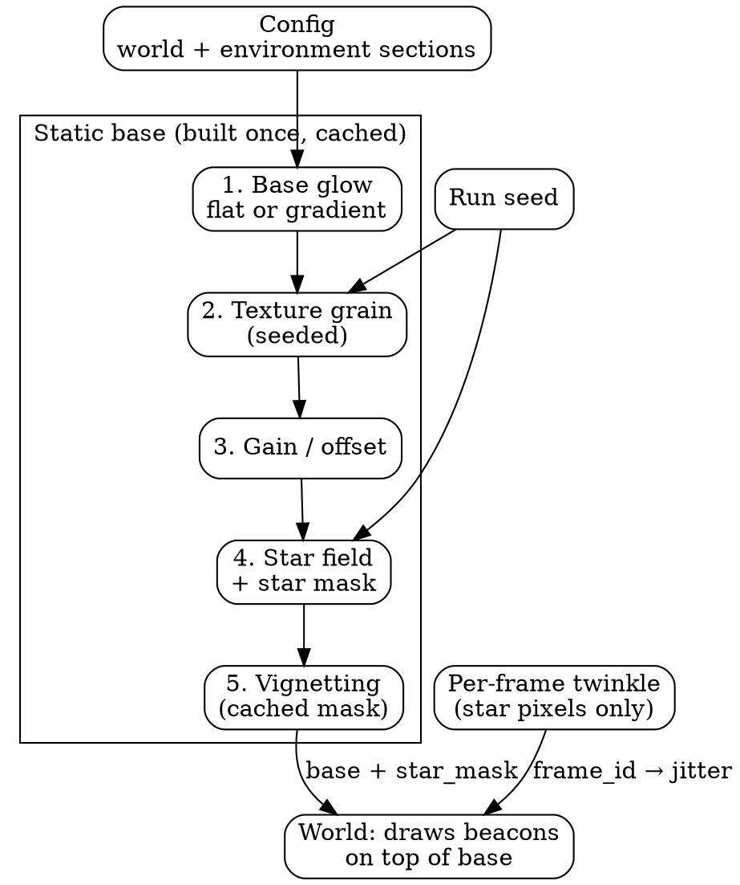

# Environment Subsystem — Complete Reference

> The fake sky: a static, seeded, hostile background that everything else happens in front of.
> One-line contract: given a config + seed, produce a deterministic 2000²-pixel world base
> image plus a star mask, rebuilt only when static inputs change.

## Table of contents

1. [Purpose and design goals](#1-purpose-and-design-goals)
2. [Where it sits in the system](#2-where-it-sits-in-the-system)
3. [Architecture diagram](#3-architecture-diagram)
4. [Build pipeline (flow)](#4-build-pipeline-flow)
5. [Per-frame path (flow)](#5-per-frame-path-flow)
6. [Components in depth](#6-components-in-depth)
7. [Caching and rebuild logic](#7-caching-and-rebuild-logic)
8. [Seeds and reproducibility](#8-seeds-and-reproducibility)
9. [Configuration reference](#9-configuration-reference)
10. [Validation rules](#10-validation-rules)
11. [Interactions with other subsystems](#11-interactions-with-other-subsystems)
12. [Measured behavior and tuning notes](#12-measured-behavior-and-tuning-notes)
13. [Tests](#13-tests)
14. [Known limits and future work](#14-known-limits-and-future-work)

---

## 1. Purpose and design goals

1. **Fair but hostile.** Dark enough that a glowing beacon stands out; cluttered enough
   that locking "the brightest dot" fails. Every layer targets a specific detector shortcut
   (see table in §6).
2. **Static and cheap.** The sky never moves, so it is rendered once per run and cached.
   Only twinkle touches pixels per frame.
3. **Bit-reproducible.** Same config + seed ⇒ pixel-identical frames, including twinkle.
   Failures are debuggable, never anecdotes.
4. **Validated.** Every knob has an enforced range; impossible skies are rejected at load.

## 2. Where it sits in the system

```
                        ┌─────────────────────┐
                        │  CONFIG + RUN SEED  │
                        └─────────┬───────────┘
                                  │
                    ┌─────────────▼─────────────┐
                    │  ENVIRONMENT SUBSYSTEM    │
                    │  base image + star mask   │
                    └─────────────┬─────────────┘
                                  │ full-world image (2000²)
                    ┌─────────────▼─────────────┐
                    │  TARGET renderer draws    │
                    │  beacons on top           │
                    └─────────────┬─────────────┘
                                  │ + per-frame twinkle
                    ┌─────────────▼─────────────┐
                    │  CAMERA cuts viewport     │
                    │  (640×480 window)         │
                    └─────────────┬─────────────┘
                                  │ small frame
                    ┌─────────────▼─────────────┐
                    │  DISTURBANCES: atmosphere │
                    │  → sensor noise → jitter  │
                    └─────────────┬─────────────┘
                                  ▼
                         DETECTOR → TRACKER → GIMBAL
```

The environment never sees the target, the camera, or the pipeline. It only answers:
*"give me the world base image (and which pixels are stars) for this config and seed."*

## 3. Architecture diagram



Layer dependency (each step assumes the previous one's output):

```
flat/gradient → texture → gain/offset → stars → vignetting → [cache] → twinkle/frame
```

## 4. Build pipeline flow

```dot
digraph build {
    rankdir=LR;
    node [shape=box, style=rounded];
    start [label="build_base(w, h, cfg, seed)", shape=ellipse];
    g [label="gradient enabled?\nYES → make_gradient\nNO → flat background"];
    t [label="texture enabled\nand strength > 0?\nYES → add 0..strength\nseeded grain"];
    go [label="gain ≠ 1 or\noffset ≠ 0?\nYES → pixel×gain+offset"];
    s [label="stars enabled?\nYES → draw field\n+ return mask"];
    v [label="vignetting enabled?\nYES → multiply\nfalloff mask"];
    done [label="(base_uint8,\nstar_mask_bool)", shape=ellipse];
    start -> g -> t -> go -> s -> v -> done;
}
```



Pseudocode of the assembly:

```python
bg = clip(world.background, 0, 80)
base = make_gradient(w, h, env, bg) if gradient_enabled else full((h, w), bg)
if texture_enabled and texture_strength > 0:
    base += uniform_int(0, strength, size=(h, w))   # seeded by run seed
if gain != 1 or offset != 0:
    base = clip(base * gain + offset)              # before stars: keeps star contrast
star_mask = zeros((h, w))
if stars_enabled:
    base, star_mask = add_stars_with_mask(base, env, seed)
if vignetting_enabled:
    base = base * vignette_mask(...)               # after stars: stars vignetted too
return base, star_mask
```

## 5. Per-frame path flow


Only the masked star pixels are touched per frame — background pixels are never rewritten,
so twinkle costs O(#stars), not O(world).

## 6. Components in depth

### 6.1 Base glow and gradient (`background` root + gradient unit)

Flat gray (`background`, 0–80, default 18) or a blend between `gradient_top` (22) and
`gradient_bottom` (38) in three shapes:

```python
linear:   project each pixel onto the angle direction, blend top→bottom
radial:   blend by distance from (center_x, center_y); angle ignored
diagonal: blend along gradient_angle in normalized coordinates
```

*Attacks:* any threshold of the form `background + k·noise` with a single global
background estimate — the bright end and dark end behave differently.

### 6.2 Texture grain

Uniform `+0…strength` per pixel (default on, strength 5, max 20), drawn from the run
seed. Mimics sensor non-uniformity.

*Attacks:* blob filters with no minimum-area guard (1-pixel specks must not count).

### 6.3 Gain / offset

`pixel × gain + offset`, gain 0.5–1.8, offset −40…+40, default neutral. Applied before
stars so star contrast survives. The "different camera / different exposure" knob.

*Attacks:* hardcoded brightness numbers anywhere downstream.

### 6.4 Star field (the main distractor)

```python
n = clip(density * w * h, 0, max_count)     # density default 0.0007, cap 0.006
rng = default_rng(stars_seed XOR run_seed)  # default star seed 1337
positions = uniform over world               # (x, y) integer pixels
magnitudes = uniform(min_mag..max_mag) × (brightness / 185)
brightest 15% also get a 3×3 glow at 45% brightness
draw with "brightest wins" so overlaps never clip
```

At defaults: ~2,800 stars on a 2000² world (~215 visible in a 640×480 viewport);
at the 0.004 stress density: ~600+ in view. Magnitudes default 90–255 at reference
brightness 185, so the brightest stars rival a dimmed target.

*Attacks:* locking the brightest dot without motion confirmation. The tracker's
prediction gate is the designated defense — stars only threaten cold search (no
prediction yet) and tiny-target tracking, exactly what the crowded/tiny presets test.

### 6.5 Twinkle

```python
seed = frame_id × 9973 + 0x9E3779B9        # stream-independent: same frame ⇒ same flicker
star_pixels += uniform_int(−amount, +amount)  # default amount 6, max 30
```

Seeded by frame counter, not by a running stream, so pause/reset/rerun reproduce
identical flicker. Legacy callers without a mask get whole-image dither; all live
callers pass the star mask so the background is untouched.

*Attacks:* detectors that trust frame-to-frame brightness instead of motion.

### 6.6 Vignetting (lens falloff)

```python
d = normalized distance from lens center (0..1)
inside radius (0.72): multiplier 1
outside: 1 − strength × ((d − radius)/(1 − radius))^falloff   # strength 0.42, quadratic
pixel ×= multiplier
```

The 32-entry LRU-cached float mask makes rebuilds cheap. Applied after stars so sky
and beacon dim together at edges, like real optics.

*Attacks:* detectors tuned only for image center; edge-acquisition cases live here.

## 7. Caching and rebuild logic

Two cache levels:

1. **World base cache.** Rebuilt only when `environment_changed(old, new)` fires:
   any of the static key set (gradient ×7, texture ×2, stars ×7 incl. seed, vignette ×6,
   gain/offset) or world size/background differs. Twinkle keys are deliberately
   excluded (per-frame cost ≈ zero).
2. **Vignette mask cache.** Pure function of `(h, w, strength, radius, falloff, cx, cy)`,
   memoized up to 32 variants.

Rule of thumb: static keys → rebuild base; twinkle/anything else → keep base.

## 8. Seeds and reproducibility

| Seed | Scope | Effect |
|---|---|---|
| Run seed | Whole run | Texture grain, star positions (XOR star seed), target motion, noise |
| `stars_seed` (default 1337) | Sky only | Shifts the entire star field without touching anything else |
| `frame_id`-derived | Twinkle only | Identical flicker per frame number, stream-independent |

Same config + seed ⇒ pixel-identical frames. Preset tuning relies on this: a failure can
be replayed frame by frame.

## 9. Configuration reference

All under `environment` (world size/background under `world`):

| Key | Default | Range | Notes |
|---|---|---|---|
| `world.width / height` | 2000 | 2000–4000 | World square, px |
| `world.background` | 18 | 0–80 | Base gray |
| `gradient_enabled` | false | bool | Flat vs gradient base |
| `gradient_type` | linear | linear/radial/diagonal | |
| `gradient_top / bottom` | 22 / 38 | 0–80 | Gray levels |
| `gradient_angle` | 90 | 0–360 | Direction (N/A for radial) |
| `gradient_center_x / y` | 0.5 | 0–1 | Radial center (fraction) |
| `texture_enabled / strength` | true / 5 | bool / 0–20 | Seeded grain |
| `brightness_gain / offset` | 1.0 / 0 | 0.5–1.8 / −40…40 | Pre-star exposure |
| `stars_enabled` | false | bool | |
| `stars_density` | 0.0007 | 0–0.006 | Fraction of pixels |
| `stars_brightness` | 185 | 0–255 | Unity-gain reference |
| `stars_min_mag / max_mag` | 90 / 255 | 0–255, min ≤ max | Per-star range |
| `stars_seed` | 1337 | 0–999999 | Sky layout selector |
| `stars_max_count` | 12000 | 0–50000 | Safety cap |
| `stars_twinkle` | false | bool | Per-frame shimmer |
| `stars_twinkle_amount` | 6 | 0–30 | Jitter amplitude |
| `vignetting_enabled` | false | bool | |
| `vignetting_strength` | 0.42 | 0–0.95 | Edge darkening |
| `vignetting_radius` | 0.72 | 0.05–1.0 | Untouched center fraction |
| `vignetting_falloff` | 2.0 | 0.3–6.0 | Curve exponent |
| `vignetting_center_x / y` | 0.5 | 0–1 | Lens center (fraction) |

## 10. Validation rules

Rejected at load (fail-fast, no silent impossible skies): unknown gradient type;
any gray/angle/texture/star/brightness value outside its row above;
`min_mag > max_mag`; vignette center outside 0–1; gain/offset outside range.
Validators read specific keys and ignore unknown ones, so additive flags
(e.g. run-mode markers) pass through untouched.

## 11. Interactions with other subsystems

* **World/target renderer** — draws beacons onto the base copy each frame, then
  twinkle, then exposes the full image. Owns positions; environment owns backdrop.
* **Camera** — cuts the 640×480 viewport; never sees the full world. Viewport
  position is what makes static stars *appear* to move (correctly handled by the
  tracker's ego-motion compensation).
* **Detector** — threshold, area/shape gates, and the prediction gate were all
  shaped by these distractors (§6 "Attacks" rows).
* **Disturbances** — atmosphere/noise/jitter apply *after* the viewport cut on the
  small frame (≈50× cheaper than full-world, mathematically identical for uniform
  effects). Fog + vignetting stack: both dim edges while thresholds stand still.
* **Presets/GUI** — crowded/tiny presets raise star density; fog presets pair with
  target size; the control deck exposes every row of §9 across its Environment tab.

## 12. Measured behavior and tuning notes

From uncued far-start stress runs (seed 42), all reproduced pixel-identically:

* ~600 in-view stars (density 0.004) pull tiny-target tracks ~28 px off — several
  stars land inside the association gate and outscore a 6 px beacon. At default
  density the same target tracks at ~1 px error. Density is the discrimination knob.
* Vignetting + fog combine against edge targets first: both dim the beacon while
  the detection threshold stands still.
* Bit-identical replay: same preset + seed ⇒ same frames, so each number above was
  debugged frame by frame rather than averaged away.

## 13. Tests

* Shared-list test: all 10 stress presets present and loadable in the GUI panel.
* GUI load tests: applying crowded/tiny presets yields the exact densities,
  brightness, vignette, and durations specified.
* Full-scene headless runs (crowded/tiny/fog presets) exercise the whole stack
  end to end; the extreme suite verdicts pin the behavior (crowded passes at
  ~0 px error; tiny tracks accurately but relocks slowly — the documented floor).

## 14. Known limits and future work

1. **Static sky only.** No moving clouds, no day/night drift, no spatially varying
   fog banks. A slow time-varying gradient would attack background estimators.
2. **Stars are single pixels (+glow).** No point-spread diversity, no saturated
   star clusters that mimic a beacon's shape score.
3. **Vignetting is centered and symmetric.** Decentered or tilted lens falloff is
   not modeled.
4. **Twinkle is white in time.** Real scintillation has temporal correlation;
   a correlated flicker would punish frame-differencing detectors harder.
5. **No occlusions.** Nothing ever passes in front of the beacon; dropout is only
   via blink/hide schedules owned by the target subsystem.
